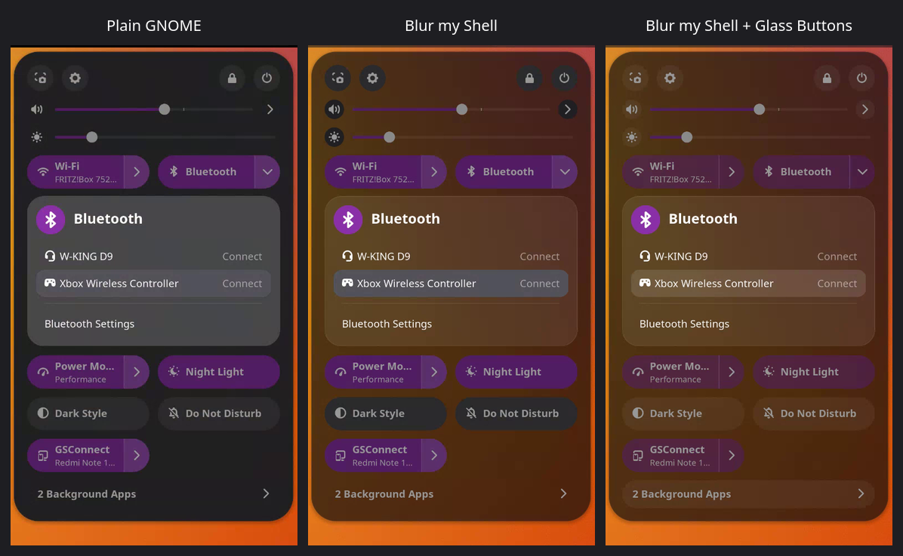
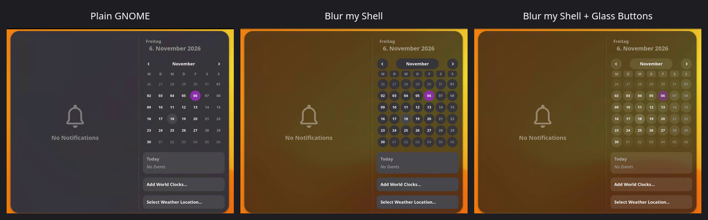
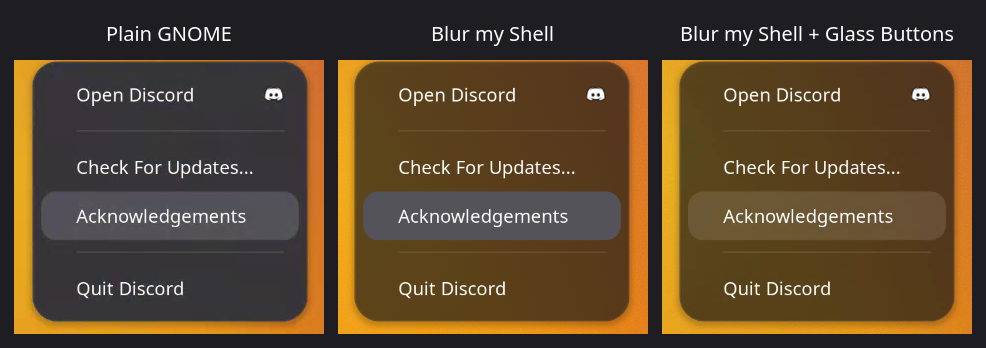

# Glass Buttons

A small GNOME Shell extension (GNOME 49–51) for a glassier shell, made to go with [Blur my Shell](https://github.com/aunetx/blur-my-shell)'s blurred popups.

## Before / after







## Features

- **Translucent buttons:** Quick Settings toggles, the calendar/notification popup and app folders get translucent glass buttons that match the blurred popups behind them, instead of solid grey or accent-colored ones.
- **Other extensions' buttons:** buttons that other extensions put in panel popup menus (for example Tiling Shell's layout picker) and the Copyous clipboard's items, search field and header/footer buttons get the same glass.
- **Menu entries:** hovered, selected and pressed entries in panel menus (including app indicator menus such as Discord's and the Background Apps list) use glass instead of solid grey.

Everything is in `stylesheet.css`; change the alpha values there to taste. The selectors come from GNOME Shell's default (Adwaita) shell theme.

The rotating `>` → `V` submenu arrows that used to be part of this extension are now a separate extension, [Rotating Arrows](https://github.com/inxomnyaa/rotating-arrows).

## Install

```sh
git clone https://github.com/inxomnyaa/glass-buttons ~/.local/share/gnome-shell/extensions/glass-buttons@inxomnyaa
# log out and back in, then:
gnome-extensions enable glass-buttons@inxomnyaa
```
